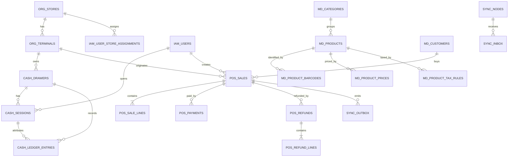

# Desain Database PostgreSQL POS
**Repository:** bangpei-arch/POS  
**Dokumen:** Desain database logis dan arsitektur penyimpanan  
**Versi:** 0.3 (baseline lokal + desain recovery sinkronisasi)  
**Tanggal:** 31 Oktober 2026  
**Acuan:** `doc/SPECIFIKASI-FUNGSIONAL-POS.md` versi 8.0  
**Status:** Desain database server toko telah memiliki baseline SQL dan test CI; belum dinyatakan production-ready. Desain cloud dipisahkan.

---

## 1. Tujuan dan batas dokumen

Dokumen ini menerjemahkan spesifikasi fungsional POS menjadi rancangan database. Isinya meliputi:

- Pembagian database central, local server toko, dan penyimpanan terminal.
- Kelompok tabel dan tanggung jawab masing-masing.
- Primary key, foreign key, unique constraint, dan indeks penting.
- Strategi transaksi offline dan sinkronisasi.
- Model kas terminal dan sesi kasir.
- Snapshot harga, pajak, promosi, pembayaran, refund, dan audit.
- Aturan retensi serta hal yang harus diuji.

Dokumen ini belum berupa SQL migration final. Nama tabel dan kolom merupakan rancangan konsisten yang akan menjadi dasar migration setelah desain logis disetujui.

## 2. Keputusan arsitektur penyimpanan

### 2.1 Tiga lapis penyimpanan

| Lapisan | Teknologi | Fungsi |
|---|---|---|
| Central server | PostgreSQL | Master otoritatif, seluruh transaksi tersinkron, laporan konsolidasi, akun, konfigurasi |
| Local server toko | PostgreSQL | Cache master pusat, transaksi toko, laporan lokal, antrean sinkronisasi ke pusat |
| Terminal POS | IndexedDB pada aplikasi PWA | Cache operasional minimum, keranjang/Hold Order lokal, transaksi dan antrean durable ketika local server/LAN tidak tersedia |

**Catatan penting:** PostgreSQL tidak tepat dipaksakan berjalan di browser terminal. Karena terminal menggunakan React/PWA, penyimpanan lokal yang disarankan adalah IndexedDB dengan transaksi atomik. Terminal mengirim data ke local server ketika LAN pulih. Local server kemudian meneruskan data ke central server. Jika implementasi terminal kelak menggunakan aplikasi desktop/native, teknologi penyimpanan terminal dapat dievaluasi ulang.

### 2.2 Model database

Central dan local server memiliki database dan migration yang terpisah. Komponen domain dapat berbagi kontrak, tetapi struktur tabel, indeks, constraint, dan hak akses ditentukan sesuai kepemilikan data. Isi datanya berbeda:

- Central menyimpan data seluruh toko.
- Local server menyimpan data satu toko, master data cache yang diperlukan, dan transaksi toko tersebut.
- Local server tidak boleh mengubah master pusat.
- Local server boleh menerima transaksi cabang dan mengirimkannya ke pusat.
- Terminal menyimpan antrean transaksi lokal ketika local server tidak tersedia.

Tidak menggunakan PostgreSQL logical replication atau replikasi dua arah untuk menyamakan database. Sinkronisasi dilakukan pada tingkat aplikasi/API.

### 2.3 Batas data dan identitas

- Primary key seluruh entitas utama menggunakan UUID; disarankan UUIDv7 untuk pengurutan waktu yang lebih baik.
- UUID dibuat di sisi yang membuat record sehingga dapat dibuat saat offline.
- Nomor struk yang dapat dibaca manusia tetap terpisah dari UUID.
- Semua record transaksi menyimpan `store_id`, `terminal_id`, dan waktu kejadian yang relevan.
- Semua waktu disimpan sebagai `timestamptz` dalam UTC; konversi tampilan dan tanggal bisnis menggunakan zona waktu toko.
- Nilai uang menggunakan `numeric(18,2)`, bukan `float` atau `double precision`.
- Kuantitas POS menggunakan integer.
- Kode dan status yang dapat berkembang menggunakan tabel referensi atau string tervalidasi di aplikasi; jangan membuat enum PostgreSQL yang sulit dimigrasikan tanpa kebutuhan kuat.

## 3. Konvensi schema

Schema awal disarankan satu schema PostgreSQL bernama `pos`. Tabel dikelompokkan secara logis berdasarkan prefix:

- `org_`: toko dan terminal.
- `iam_`: pengguna, peran, dan otorisasi.
- `md_`: master produk, harga, pajak, promosi, pelanggan.
- `pos_`: keranjang, penjualan, pembayaran, refund, Hold Order.
- `cash_`: laci kas, sesi, ledger kas, setoran, serah terima.
- `sync_`: inbox, outbox, delivery, checkpoint.
- `audit_`: audit log.
- `ops_`: jam operasional, printer, alert, backup metadata.

Prefix adalah pengelompokan logis; tidak wajib membuat PostgreSQL schema terpisah untuk setiap kelompok.

## 4. Model organisasi dan perangkat

### 4.1 Tabel

| Tabel | Kolom inti | Keterangan |
|---|---|---|
| `org_stores` | id, code, name, timezone, currency_code, is_active | Master toko dari central |
| `org_terminals` | id, store_id, code, name, primary_cashier_id, app_version, is_active, disabled_at | Identitas terminal; unik per toko |
| `org_store_servers` | id, store_id, server_code, last_seen_at, app_version, status | Registrasi/monitoring local server |
| `org_terminal_status` | id, terminal_id, status, observed_at, app_version, details | Riwayat heartbeat dan status terminal |
| `ops_store_hours` | id, store_id, weekday, opens_at, closes_at, effective_from, effective_until, is_closed | Jam operasional efektif per toko |
| `ops_store_exceptions` | id, store_id, starts_at, ends_at, reason, created_by | Hari libur/jam khusus |
| `ops_terminal_printers` | id, terminal_id, connection_type, printer_config, is_default | Konfigurasi printer per terminal |

Constraint utama:
- `org_stores.code` unique.
- `org_terminals(store_id, code)` unique.
- `org_terminals.store_id` FK ke `org_stores`.
- Terminal tidak dihapus fisik jika sudah memiliki transaksi; gunakan status aktif/nonaktif.

### 4.2 Jam operasional

Jam reguler dan pengecualian disimpan terpisah agar hari libur dan jam khusus tidak menimpa pola mingguan. Waktu operasional harus mendukung toko yang tutup melewati tengah malam; implementasi perlu menyimpan aturan hari bisnis dan menguji rentang lintas hari.

## 5. Pengguna dan akses

| Tabel | Kolom inti | Keterangan |
|---|---|---|
| `iam_users` | id, employee_code, full_name, pin_hash, status, failed_pin_attempts, locked_until | Identitas pegawai dan hash PIN |
| `iam_roles` | id, code, name | Lima role utama |
| `iam_permissions` | id, code, description | Izin granular per aksi |
| `iam_role_permissions` | role_id, permission_id | Pemetaan role ke permission |
| `iam_user_store_assignments` | id, user_id, store_id, valid_from, valid_until | Penempatan pegawai pada toko |
| `iam_user_role_assignments` | id, user_id, role_id, store_id, valid_from, valid_until | Role global atau dalam lingkup toko |
| `iam_pin_reset_events` | id, user_id, reset_by, created_at, method | Riwayat reset/unlock tanpa menyimpan PIN lama |
| `iam_terminal_authorizations` | id, user_id, terminal_id, authorized_by, expires_at | Izin penggunaan terminal non-primary bila diperlukan |

Ketentuan:
- `employee_code` unique.
- PIN tidak pernah disimpan dalam bentuk plaintext.
- Reset PIN tidak mengungkap PIN lama.
- Perubahan role, penempatan, status, dan reset PIN menghasilkan audit event.
- Hak akses harus dicek di backend, bukan hanya menyembunyikan tombol frontend.
- Akses data selalu dibatasi berdasarkan role dan store scope.

## 6. Master data produk dan harga

| Tabel | Kolom inti | Keterangan |
|---|---|---|
| `md_categories` | id, code, name, parent_id, sort_order, is_active, version | Kategori produk |
| `md_products` | id, sku, name, description, category_id, base_uom_code, image_uri, is_active, version | Master produk/SKU |
| `md_product_barcodes` | id, product_id, barcode, barcode_type, is_active | Satu produk dapat memiliki banyak barcode |
| `md_product_prices` | id, product_id, price, valid_from, valid_until, version, created_by | Riwayat harga efektif |
| `md_product_tax_rules` | id, product_id, tax_code, tax_rate, valid_from, valid_until, version | Tarif pajak per produk |
| `md_product_store_availability` | id, product_id, store_id, is_available, reason, updated_at | Ketersediaan lokal toko tanpa mengubah master global |
| `md_product_display_order` | id, terminal_id, product_id, sort_order, is_favorite | Urutan/favorit yang dikonfigurasi pusat |
| `md_uoms` | code, name, description | Referensi UoM dasar untuk informasi produk |

Constraint utama:
- `md_products.sku` unique.
- `md_product_barcodes.barcode` unique untuk barcode aktif.
- Harga dan tarif pajak memiliki rentang efektif yang tidak boleh overlap untuk produk dan jenis konfigurasi yang sama.
- Harga/tarif yang sudah dipakai transaksi tidak diubah; buat versi/record efektif baru.
- Produk dinonaktifkan secara soft delete/status, bukan hard delete.
- Produk dengan variasi berbeda adalah record SKU terpisah.

Master produk/harga/pajak disinkronkan ke local server dan cache terminal. Perubahan berlaku untuk transaksi baru setelah versi efektif diterima. Snapshot transaksi tetap menjadi sumber historis.

## 7. Pelanggan

| Tabel | Kolom inti | Keterangan |
|---|---|---|
| `md_customers` | id, name, normalized_phone, address, date_of_birth, status, created_at, updated_at | Master pelanggan |
| `md_customer_merge_events` | id, source_customer_id, target_customer_id, merged_by, reason, merged_at | Riwayat penggabungan pelanggan |
| `md_customer_phone_aliases` | id, customer_id, normalized_phone, is_primary | Nomor telepon alternatif bila kebijakan mengizinkan |

Constraint:
- Nomor telepon ternormalisasi harus unik untuk pelanggan aktif sesuai kebijakan pusat.
- Pelanggan default “Umum” sebaiknya berupa record sistem yang stabil, bukan nilai nama yang dibuat ulang pada setiap transaksi.
- Registrasi offline menggunakan UUID lokal; konflik nomor telepon saat sinkronisasi masuk antrean resolusi, bukan membuat duplikat otomatis.
- Data pelanggan tidak aktif tidak dihapus otomatis.

## 8. Promosi dan diskon

| Tabel | Kolom inti | Keterangan |
|---|---|---|
| `md_promotions` | id, code, name, promotion_type, starts_at, ends_at, priority, is_active, version | Header promosi |
| `md_promotion_conditions` | id, promotion_id, condition_type, condition_data | Syarat minimum belanja, member, produk, dan lainnya |
| `md_promotion_benefits` | id, promotion_id, benefit_type, benefit_data | Persentase, nominal, bundle, harga khusus |
| `md_promotion_products` | promotion_id, product_id, scope_type | Cakupan produk |
| `md_promotion_quotas` | id, promotion_id, total_limit, per_customer_limit | Batas pemakaian |
| `md_promotion_usage` | id, promotion_id, customer_id, sale_id, usage_key, used_at | Penggunaan kuota yang idempotent |
| `md_manual_discount_limits` | id, supervisor_user_id/role_id, max_percent, max_amount, valid_from, valid_until | Batas diskon Supervisor |
| `pos_sale_discounts` | id, sale_id, sale_line_id, discount_type, amount, reason, applied_by, source, promotion_id | Diskon aktual transaksi |
| `pos_promotion_cancellations` | id, sale_id, promotion_id, reason, cancelled_by, cancelled_at | Pembatalan promosi otomatis oleh Supervisor |

Catatan:
- Snapshot syarat/manfaat promosi yang benar-benar dipakai disimpan di transaksi agar perubahan master tidak mengubah histori.
- Kuota promosi tidak boleh dihitung hanya dari jumlah retry API; `usage_key` harus unik dan stabil.
- Pemilihan promosi terbaik harus deterministik dan dapat diuji.

## 9. Keranjang dan Hold Order

| Tabel | Kolom inti | Keterangan |
|---|---|---|
| `pos_carts` | id, store_id, terminal_id, created_by, status, customer_id, created_at, updated_at | Keranjang aktif/draft |
| `pos_cart_lines` | id, cart_id, product_id, sku_snapshot, name_snapshot, barcode_snapshot, quantity, unit_price_snapshot, note | Baris keranjang |
| `pos_hold_orders` | id, cart_id, hold_number, held_by, held_at, last_resumed_at, status | Identitas Hold Order |
| `pos_cart_events` | id, cart_id, event_type, actor_id, occurred_at, event_data | Riwayat perubahan/penghapusan item dan status keranjang |

Ketentuan:
- Hold Order tidak memiliki expiry otomatis.
- Hanya pembuat yang boleh resume atau delete.
- Hold Order tidak masuk penjualan dan tidak mengurangi stok.
- Keranjang yang sedang dibuka harus tersimpan secara lokal dan tahan restart.
- Cart line menggunakan ID unik agar pemindaian barcode berulang dapat membuat baris terpisah.
- Ketika transaksi dimulai, harga/tax/promotion version yang digunakan harus dibekukan konsisten pada snapshot yang dibutuhkan.

## 10. Penjualan

| Tabel | Kolom inti | Keterangan |
|---|---|---|
| `pos_sales` | id, receipt_number, store_id, terminal_id, cashier_id, customer_id, business_date, status, currency_code, subtotal, discount_total, tax_total, rounding_amount, grand_total, paid_at, created_at | Header penjualan |
| `pos_sale_lines` | id, sale_id, product_id, sku_snapshot, name_snapshot, barcode_snapshot, quantity, unit_price, gross_amount, discount_amount, taxable_base, tax_code_snapshot, tax_rate_snapshot, tax_amount, line_total, price_version, tax_version, promotion_snapshot | Detail penjualan dan snapshot |
| `pos_sale_status_events` | id, sale_id, old_status, new_status, actor_id, reason, occurred_at | Riwayat status |
| `pos_sale_number_sequences` | id, terminal_id, business_date, next_number, updated_at | Sequence nomor struk lokal/terminal |
| `pos_sale_notes` | id, sale_id, note, created_by, created_at | Catatan transaksi bila diperlukan |

Constraint:
- `pos_sales.id` UUID PK.
- `pos_sales.receipt_number` unique pada central dan unique lokal setidaknya dalam satu toko; format mengandung kode toko, tanggal bisnis, kode terminal, dan sequence.
- `pos_sales(store_id, terminal_id, business_date, receipt_number)` dapat diberi indeks untuk pencarian operasional.
- `pos_sale_lines.sale_id` FK ke header.
- Transaksi PAID bersifat immutable. Koreksi melalui refund/reversal, bukan update detail.
- Snapshot nama/SKU/barcode/harga/tax/promotion wajib tetap tersedia meskipun master produk berubah atau dinonaktifkan.
- Simpan waktu kejadian UTC dan tanggal bisnis toko secara eksplisit.
- Perhitungan total harus dilakukan backend dengan decimal presisi; jangan mempercayai total dari browser.

### 10.1 Nomor struk offline

Format: `STORECODE-YYYYMMDD-TERMINALCODE-SEQUENCE`.

Sequence dialokasikan secara atomik di terminal. Saat local server pulih, transaksi diimpor tanpa mengganti receipt number. Unique constraint di pusat menjadi lapisan validasi tambahan. UUID tetap menjadi primary identity dan idempotency key.

## 11. Pembayaran

| Tabel | Kolom inti | Keterangan |
|---|---|---|
| `md_payment_methods` | id, code, name, method_type, requires_reference, is_cash, is_active, version | Metode pembayaran configurable |
| `pos_payments` | id, sale_id, payment_method_id, amount, status, reference_number, confirmed_by, confirmed_at, created_at | Satu baris per komponen split tender |
| `pos_payment_evidence` | id, payment_id, file_uri, content_type, uploaded_at, uploaded_by | Metadata bukti; file disimpan di object/file storage |
| `pos_payment_events` | id, payment_id, old_status, new_status, actor_id, reason, occurred_at | Jejak konfirmasi dan perubahan status |

Ketentuan:
- Satu sale dapat memiliki banyak payment rows untuk split payment.
- Jumlah pembayaran yang sukses harus cocok dengan jumlah yang harus dibayar sesuai aturan pembulatan.
- Non-tunai memerlukan reference number dan konfirmasi kasir.
- Status tidak jelas memakai PAYMENT_PENDING dan tidak boleh diulang sebelum verifikasi Supervisor.
- File bukti tidak disimpan sebagai blob besar di tabel transaksi; database menyimpan URI dan metadata.
- Payment event tidak boleh dihapus.

## 12. Refund dan reversal

| Tabel | Kolom inti | Keterangan |
|---|---|---|
| `pos_refunds` | id, original_sale_id, store_id, terminal_id, processed_by, refund_method_id, reason, total_amount, status, created_at, completed_at | Header refund |
| `pos_refund_lines` | id, refund_id, original_sale_line_id, quantity, refund_amount, item_received, item_resalable, stock_return_eligible | Detail refund per item |
| `pos_refund_payments` | id, refund_id, payment_method_id, amount, reference_number, status | Detail pembayaran pengembalian dana |
| `pos_refund_events` | id, refund_id, event_type, actor_id, reason, occurred_at | Jejak persetujuan dan proses |
| `sync_inventory_events` | id, source_type, source_id, event_type, payload, idempotency_key, status | Event dampak inventori dari sale/refund |

Constraint dan aturan:
- Refund selalu merujuk sale asal.
- Total kuantitas refund per sale line tidak boleh melebihi kuantitas yang dijual dikurangi refund terdahulu.
- Total nilai refund tidak boleh melebihi nilai yang dapat direfund dari transaksi asal.
- Validasi agregat refund memerlukan transaksi database/locking yang benar; CHECK constraint biasa tidak cukup.
- Refund dapat sebagian atau penuh.
- Stok hanya dikembalikan bila barang diterima dan layak jual.
- Refund uang dan event pengembalian stok dipisahkan.
- Event inventori memiliki idempotency key sendiri.

## 13. Sesi kasir dan laci kas

Ini bagian yang paling penting untuk dirancang hati-hati karena sesi melekat pada kasir, sedangkan laci/modal kas melekat pada terminal.

| Tabel | Kolom inti | Keterangan |
|---|---|---|
| `cash_drawers` | id, store_id, terminal_id, fixed_float_amount, currency_code, is_active | Laci kas fisik per terminal |
| `cash_drawer_float_history` | id, drawer_id, old_amount, new_amount, changed_by, reason, changed_at | Perubahan modal oleh Central Admin |
| `cash_sessions` | id, drawer_id, store_id, terminal_id, cashier_id, status, opened_at, closed_at, opening_counted, closing_counted, expected_cash, variance_amount | Sesi individu kasir |
| `cash_ledger_entries` | id, drawer_id, session_id, entry_type, amount, direction, source_type, source_id, actor_id, approved_by, reason, occurred_at | Mutasi uang kas |
| `cash_handover_events` | id, drawer_id, from_session_id, to_session_id, from_cashier_id, to_cashier_id, counted_by_from, counted_by_to, amount, variance, supervisor_id, reason, confirmed_at | Serah terima kasir |
| `cash_deposits` | id, drawer_id, store_id, amount, expected_amount, variance, recorded_by, reason, deposited_at, status | Setoran harian |
| `cash_session_events` | id, session_id, event_type, actor_id, reason, occurred_at, event_data | Riwayat sesi |

### 13.1 Model saldo

- Modal tetap berada pada `cash_drawers.fixed_float_amount`; perubahan dicatat di history.
- Modal fisik tidak boleh ditambahkan ulang sebagai modal baru setiap kali kasir berganti.
- Setiap penerimaan tunai, kembalian, refund tunai, cash in, cash out, dan setoran menjadi ledger entry.
- Setiap entry memiliki referensi sumber agar tidak dicatat dua kali.
- Expected drawer balance dihitung dari saldo awal/modal dan seluruh ledger movement sampai waktu perhitungan.
- Sesi kasir mencatat hitungan fisik dan tanggung jawab kasir selama periode sesi.
- Saat pergantian kasir, saldo drawer menjadi saldo pembuka tanggung jawab kasir berikutnya tanpa menggandakan modal.
- Setoran mengurangi saldo fisik drawer; modal tetap disisakan sesuai konfigurasi.
- Cash in/out dan deposit memerlukan otorisasi sesuai spesifikasi.
- Selisih dicatat, bukan dibuat sebagai koreksi kas otomatis.

### 13.2 Validasi konsistensi

Penerimaan tunai dari penjualan harus membuat ledger entry satu kali dan terkait dengan payment ID. Refund tunai membuat entry keluar. Split tender hanya membuat ledger untuk komponen tunai. Gunakan unique constraint pada `(source_type, source_id, entry_type)` atau kunci idempotensi yang sesuai untuk mencegah posting kas ganda.

## 14. Audit log

| Tabel | Kolom inti | Keterangan |
|---|---|---|
| `audit_events` | id, store_id, terminal_id, actor_id, action, entity_type, entity_id, reason, before_data, after_data, occurred_at, correlation_id | Audit aktivitas penting |
| `audit_deletion_events` | id, original_audit_event_id, deleted_by, reason, confirmed_at | Jejak terpisah saat penghapusan audit diizinkan |

Ketentuan:
- Audit dibuat append-only oleh aplikasi.
- Akses baca/ekspor dibatasi Central Admin dan Owner.
- Jika kebijakan mengizinkan penghapusan oleh Central Admin, penghapusan harus melalui prosedur khusus dan meninggalkan deletion event yang tidak ikut terhapus.
- Data sensitif seperti PIN, token, credential, dan data rahasia tidak boleh masuk before/after JSON.
- Retensi audit: 3 tahun.
- Untuk perlindungan lebih kuat, pertimbangkan role database terpisah dan penyimpanan log append-only di luar database operasional.

## 15. Sinkronisasi: inbox dan outbox

| Tabel | Kolom inti | Keterangan |
|---|---|---|
| `sync_outbox` | id, event_id, aggregate_type, aggregate_id, event_type, payload, occurred_at, status, attempts, next_retry_at, last_error | Event lokal yang harus dikirim |
| `sync_inbox` | id, source_node_id, event_id, idempotency_key, received_at, processing_status, response_payload | Event masuk dan deduplikasi |
| `sync_delivery_attempts` | id, outbox_id, attempted_at, result, response_code, error_message | Riwayat retry |
| `sync_nodes` | id, node_type, store_id, terminal_id, node_code, last_seen_at, status | Identitas node sinkronisasi |
| `sync_checkpoints` | id, node_id, stream_name, last_acked_at, last_event_id | Posisi sinkronisasi |
| `sync_master_versions` | id, entity_type, entity_id, version, effective_at, published_at | Versi master yang diterima node |

Ketentuan:
- Event bisnis dan outbox harus dibuat dalam satu transaksi PostgreSQL yang sama.
- Event terminal ketika local server mati disimpan di IndexedDB; saat server pulih, terminal mengirim event ke local server dan server membuat outbox server-side.
- Central menerima event melalui inbox dengan unique constraint pada `(source_node_id, event_id)` dan/atau idempotency key.
- Pemrosesan event dan pencatatan inbox harus atomik.
- Acknowledgement hanya diberikan setelah event berhasil diproses atau ditandai sebagai duplikat yang sudah diproses.
- Retry memakai exponential backoff dengan jitter, batas percobaan dan dead-letter/failed state untuk investigasi; sistem tetap dapat mencoba ulang setelah tindakan perbaikan.
- Urutan event dijaga per aggregate/terminal bila urutan bisnis diperlukan. Jangan mengandalkan satu urutan global untuk semua toko.
- Payload event diberi schema_version agar kontrak dapat berevolusi.
- Jangan menghapus transaksi sumber hanya karena outbox sudah terkirim.

### 15.1 Recovery, lease, dan ordering (migration 004)

Migration `004_sync_recovery_ordering.sql` menambahkan aturan teknis berikut pada database lokal:

- Outbox mendapat `aggregate_version` monotonik per node + aggregate type + aggregate ID. Counter dialokasikan atomik pada transaksi insert.
- Worker claim memakai `FOR UPDATE SKIP LOCKED`, default lease 120 detik (rentang fungsi 15–900 detik), dan fencing token UUID.
- Lease kedaluwarsa dapat diambil worker lain. ACK/failure dari claim lama ditolak.
- Event dikirim at-least-once. Penerima wajib idempotent; tidak ada asumsi exactly-once pada jaringan.
- Claim hanya mengambil versi paling awal yang belum ACK pada aggregate yang sama. Event failed memblokir versi berikutnya sampai resolusi operasional.
- Inbox mempunyai cursor per source node + aggregate. Hanya versi cursor + 1 yang dapat diproses. Efek bisnis penerima, cursor, dan status inbox processed wajib commit atomik.
- Idempotency key inbox unik dalam lingkup source node: `(source_node_id, idempotency_key)`.
- Inventory API queue tetap terpisah tetapi menggunakan lease/fencing/retry/ACK dan attempt history.
- Exponential backoff + full jitter dihitung worker. Rekomendasi awal base 2 detik, cap 15 menit, maksimum 12 attempt; seluruhnya konfigurasi worker.
- `sync_checkpoints` hanya watermark observabilitas sampai global stream sequence ditentukan; jangan gunakan sebagai resume cursor atau dasar skip event.

Detail kontrak dan batas implementasi ada di `doc/SYNC-RECOVERY-AUDIT.md`.

## 16. Cache stok dan inventori

| Tabel | Kolom inti | Keterangan |
|---|---|---|
| `md_stock_cache` | id, store_id, product_id, quantity, source_updated_at, fetched_at, source_version | Snapshot stok terakhir dari sistem inventori |
| `sync_inventory_events` | id, source_type, source_id, event_type, payload, idempotency_key, status, attempts | Penjualan/refund yang harus dikirim ke inventori |

Stok adalah informasi cache, bukan sumber kebenaran inventori POS. Simpan waktu sumber dan waktu pengambilan. Jika API tidak tersedia, tetap izinkan penjualan dan tampilkan snapshot terakhir dengan timestamp. POS tidak boleh mengubah saldo stok pusat secara langsung.

## 17. Printer, alert, dan monitoring

| Tabel | Kolom inti | Keterangan |
|---|---|---|
| `ops_print_jobs` | id, terminal_id, sale_id, job_type, status, created_at, completed_at, error_message | Status cetak struk |
| `ops_reprint_events` | id, sale_id, terminal_id, actor_id, reason, printed_at | Riwayat cetak ulang |
| `ops_alerts` | id, store_id, terminal_id, alert_type, severity, message, created_at, acknowledged_by, acknowledged_at, resolved_at | Alert operasional |
| `ops_backup_runs` | id, node_id, started_at, completed_at, status, artifact_uri, size_bytes, checksum | Metadata hasil backup dan uji |

Bukti pembayaran dan lampiran disimpan pada object/file storage, bukan sebagai file besar di PostgreSQL. Database menyimpan URI, checksum, ukuran, tipe konten, dan metadata akses.

## 18. Relasi inti (ERD ringkas)

Diagram berikut menggambarkan hubungan inti; bukan seluruh kolom dan constraint.

## 19. Indeks dan constraint penting

Indeks awal yang disarankan:

- Unique: `org_stores(code)`.
- Unique: `org_terminals(store_id, code)`.
- Unique: `iam_users(employee_code)`.
- Unique: `md_products(sku)`.
- Unique partial: barcode aktif pada `md_product_barcodes(barcode)`.
- Unique: `pos_sales(receipt_number)` pada database pusat.
- Unique: `sync_inbox(source_node_id, event_id)`.
- Unique: `sync_outbox(event_id)`.
- Unique: `pos_payments(reference_number, payment_method_id)` bila aturan provider menjamin uniqueness; jangan memaksakan bila reference tidak global.
- Index: `pos_sales(store_id, business_date, created_at)`.
- Index: `pos_sales(cashier_id, created_at)`.
- Index: `pos_sale_lines(product_id, sale_id)`.
- Index: `pos_payments(payment_method_id, created_at)`.
- Index: `sync_outbox(status, next_retry_at, occurred_at)`.
- Index: `sync_inbox(processing_status, received_at)`.
- Index: `cash_ledger_entries(drawer_id, occurred_at)`.
- Index: `audit_events(occurred_at, actor_id, store_id)`.
- Index: `md_customers(normalized_phone)`.

Gunakan foreign key dan NOT NULL untuk relasi wajib. Gunakan CHECK untuk nilai positif/non-negatif yang memang berlaku universal. Aturan lintas-baris seperti batas total refund, kuota promosi, dan saldo kas harus dijaga dengan transaksi/locking atau prosedur database yang teruji, bukan CHECK sederhana.

## 20. Strategi transaksi database

### 20.1 Finalisasi penjualan

Dalam satu transaksi database di node yang menerima pembayaran:
1. Lock keranjang/record transaksi agar tidak difinalisasi dua kali.
2. Validasi status dan total pembayaran.
3. Simpan header dan baris sale beserta snapshot.
4. Simpan payment rows dan payment events.
5. Ubah status menjadi PAID.
6. Buat ledger entry untuk komponen tunai.
7. Buat outbox event untuk central dan event inventori.
8. Commit.
9. Cetak struk melalui print job setelah transaksi committed.

Jika terminal sedang tidak dapat mencapai local server, terminal harus menyimpan event penjualan dan pembayaran secara atomik di IndexedDB sebelum menampilkan transaksi sebagai berhasil. Implementasi terminal harus memiliki mekanisme durable write dan recovery.

### 20.2 Refund

Dalam satu transaksi:
1. Lock sale line asal dan hitung total refund sebelumnya.
2. Validasi kuantitas dan nominal yang tersisa untuk direfund.
3. Simpan refund header, detail, dan metode pengembalian dana.
4. Simpan event refund.
5. Buat cash ledger entry bila refund tunai.
6. Buat event inventori hanya untuk item yang diterima kembali dan layak jual.
7. Buat outbox event.
8. Commit.

### 20.3 Penggunaan kuota promosi

- Reservasi/penggunaan kuota harus memiliki kunci idempotent.
- Saat offline, kuota pusat tidak dapat dijamin konsisten lintas toko tanpa koordinasi. Karena itu, kuota global yang ketat memerlukan strategi alokasi kuota per toko/node atau kebijakan penerimaan sementara yang kemudian direkonsiliasi. Ini merupakan isu desain yang harus ditetapkan sebelum fitur kuota global diaktifkan offline.

## 21. Retensi, arsip, dan partisi

- Data transaksi, receipt, dan pembayaran memiliki retensi 5 tahun.
- Audit log memiliki retensi 3 tahun.
- Backup memiliki retensi 90 hari.
- Arsip tetap dapat dicari dan dilaporkan; arsip bukan backup.
- Legal hold mengecualikan data dari penghapusan.
- Pertimbangkan partisi bulanan untuk tabel transaksi besar: `pos_sales`, `pos_sale_lines`, `pos_payments`, `audit_events`, `sync_delivery_attempts`.
- Strategi partisi harus memperhatikan unique constraint global. UUID tetap primary identity; nomor struk dijamin unik melalui desain key/registry yang sesuai jika tabel dipartisi.
- Retensi lima tahun dihitung dari tanggal transaksi sesuai kebijakan bisnis dan legal yang berlaku.
- Proses archive/delete harus berupa job terjadwal, idempotent, tercatat, dan diuji pemulihannya.

## 22. Keamanan dan operasional PostgreSQL

- Gunakan role database terpisah untuk migration, aplikasi, read-only reporting, dan backup.
- Aplikasi tidak boleh menggunakan superuser PostgreSQL.
- Kredensial disimpan di secret manager/environment yang terlindungi, bukan repository.
- Koneksi antarserver menggunakan TLS.
- Backup dienkripsi dan checksum diverifikasi.
- Data pelanggan dan bukti pembayaran dibatasi sesuai hak akses.
- Audit tidak boleh merekam PIN, password, token, atau secret.
- Query laporan berat sebaiknya menggunakan read replica/materialized view atau tabel agregasi setelah volume terukur; jangan mengganggu transaksi kasir.
- Migration harus versioned dan diuji di development/staging sebelum production.
- Local server harus dapat berjalan tanpa koneksi central.

## 23. Hal yang masih memerlukan keputusan/uji teknis

Spesifikasi fungsional yang telah disepakati tidak dibuka ulang. Item di bawah adalah pekerjaan teknis yang belum selesai:

1. **Promosi berkuota lintas toko saat offline:** kuota global ketat memerlukan alokasi per toko atau reservasi online. Tanpa koordinasi, toko offline tidak dapat menjamin kuota global.
2. **Snapshot cart:** implementasi harus membuat snapshot harga/pajak ketika item masuk cart sesuai aturan transaksi terbuka; perubahan master baru tidak mengubah snapshot yang sudah ada.
3. **Rekonsiliasi kas:** test lintas skenario pembukaan, penjualan tunai, cash in/out, handover, setoran, penutupan, dan variance.
4. **Pembayaran non-tunai pending:** state transition dan otorisasi keputusan akhir perlu dituangkan dalam matriks permission dan test.
5. **Nomor struk:** uji multi-terminal, pergantian tanggal bisnis, jam terminal salah, dan restart sequence.
6. **Pajak/pembulatan:** test vector tarif campuran, diskon, split payment, dan pembulatan.
7. **Sinkronisasi terminal–toko–cloud:** migration 004 dan test database menguji lease, fencing, aggregate ordering, inbox cursor, serta concurrent claim. Test integrasi HTTP terminal–toko–cloud saat LAN/local server mati, duplicate delivery setelah receiver commit, dan cloud outage tetap belum dibuat.
8. **Hak akses:** finalisasi matriks permission per endpoint dan aksi.
9. **Retensi/partisi:** validasi ukuran aktual dan kebutuhan laporan sebelum partisi historis diterapkan.

## 24. Tahapan implementasi database

Tahapan baseline lokal telah berjalan:
1. Baseline schema 001 dibuat.
2. Integrity guards 002 dibuat dan diuji.
3. Transaction finality/refund settlement guards 003 dibuat dan diuji di CI.
4. Test 001–005 dan concurrency refund dimasukkan ke GitHub Actions.

Tahapan berikutnya:
5. Terapkan migration 003 pada database development lokal dan jalankan ulang test 001–005.
6. Selesaikan audit outbox/inbox recovery (lease, retry, ordering, atomic ACK).
7. Selesaikan test integrasi terminal–local server–cloud.
8. Finalisasi desain cloud dan migration cloud terpisah.
9. Uji restore backup dan pemulihan node.
10. Baru setelah itu tetapkan baseline database siap untuk implementasi aplikasi.

**Catatan:** migration lokal tidak boleh diterapkan ke cloud. Lihat `doc/DATABASE-BOUNDARIES-LOCAL-CLOUD.md`.

## 25. Dokumen turunan dan status pekerjaan

- `doc/ERD-DATA-DICTIONARY.md`: ERD domain ditambah ERD tabel pendukung; data dictionary melengkapi empat tabel yang sebelumnya tertinggal.
- `database/migrations/001_initial_schema.sql`: baseline schema server toko.
- `database/migrations/002_integrity_guards.sql`: pembayaran dan batas kumulatif refund.
- `database/migrations/003_transaction_finality.sql`: finality penjualan/refund, rekonsiliasi settlement refund, dan indeks query tambahan.
- `database/migrations/004_sync_recovery_ordering.sql`: aggregate version, lease/fencing, inbox cursor, retry/ACK, dan inventory queue recovery.
- `database/tests/006_sync_recovery_ordering.sql` dan `007_sync_claim_concurrency.py`: regression ordering/recovery dan concurrent worker claim.
- `database/tests/001_schema_smoke.sql` sampai `005_transaction_finality.sql`: smoke, audit, regression, dan finality.
- `database/tests/004_refund_concurrency.py`: uji dua proses refund bersamaan.
- `doc/DATABASE-BOUNDARIES-LOCAL-CLOUD.md`: batas kepemilikan data server toko dan cloud.

**Status test CI:** migration 001–003, test 001–005, dan concurrency refund sebelumnya lulus pada GitHub Actions run 41139337931. Migration 004 dan test 006–007 lulus pada GitHub Actions run [41150146313](https://github.com/bangpei-arch/POS/actions/runs/41150146313), PostgreSQL 16. Ini belum membuktikan penerapan pada database development lokal atau integrasi HTTP end-to-end.

**Status lokal pengguna:** migration 003 dan test 001–005 serta refund concurrency telah dilaporkan lulus pada database development. Migration 004 belum diterapkan ke database development lokal; perlu backup baru sebelum penerapan dan menjalankan test 001–007.
