# ERD Rinci dan Data Dictionary POS
**Versi:** 0.2  
**Acuan:** Spesifikasi Fungsional POS v8.0 dan Desain Database PostgreSQL v0.1  
**Status:** Audit dokumentasi schema server toko; belum production-certified

## 1. Konvensi

- Semua PK utama: \`UUID\`; aplikasi membuat UUID sebelum sinkronisasi.
- Waktu: \`timestamptz\` UTC; tanggal bisnis: \`date\` sesuai zona waktu toko.
- Uang: \`numeric(18,2)\`; jangan gunakan floating point.
- Kuantitas POS: integer positif.
- Soft delete/status digunakan untuk master yang telah direferensikan transaksi.
- Snapshot transaksi tidak bergantung pada master yang dapat berubah.
- Kolom \`created_at\` dan \`updated_at\` tersedia pada tabel master/transaksi yang perlu dilacak.
- Nama kolom \`*_id\` adalah FK kecuali dinyatakan sebagai identifier eksternal.

## 2. ERD tingkat domain

### 2.1 Organisasi, identitas, dan hak akses

\`\`\`mermaid
erDiagram
  ORG_STORES ||--o{ ORG_TERMINALS : has
  ORG_STORES ||--o{ ORG_STORE_SERVERS : served_by
  ORG_STORES ||--o{ IAM_USER_STORE_ASSIGNMENTS : assigns
  ORG_TERMINALS ||--o{ IAM_TERMINAL_AUTHORIZATIONS : authorizes
  IAM_USERS ||--o{ IAM_USER_STORE_ASSIGNMENTS : assigned
  IAM_USERS ||--o{ IAM_USER_ROLE_ASSIGNMENTS : receives
  IAM_ROLES ||--o{ IAM_USER_ROLE_ASSIGNMENTS : grants
  IAM_ROLES ||--o{ IAM_ROLE_PERMISSIONS : contains
  IAM_PERMISSIONS ||--o{ IAM_ROLE_PERMISSIONS : included
  ORG_STORES ||--o{ OPS_STORE_HOURS : configures
  ORG_STORES ||--o{ OPS_STORE_EXCEPTIONS : configures
  ORG_TERMINALS ||--o{ OPS_TERMINAL_PRINTERS : configures
\`\`\`

### 2.2 Master produk, pelanggan, promosi

\`\`\`mermaid
erDiagram
  MD_CATEGORIES ||--o{ MD_PRODUCTS : groups
  MD_CATEGORIES ||--o{ MD_CATEGORIES : parent
  MD_PRODUCTS ||--o{ MD_PRODUCT_BARCODES : has
  MD_PRODUCTS ||--o{ MD_PRODUCT_PRICES : priced
  MD_PRODUCTS ||--o{ MD_PRODUCT_TAX_RULES : taxed
  MD_PRODUCTS ||--o{ MD_PRODUCT_STORE_AVAILABILITY : available
  ORG_STORES ||--o{ MD_PRODUCT_STORE_AVAILABILITY : scopes
  MD_CUSTOMERS ||--o{ MD_CUSTOMER_MERGE_EVENTS : source_or_target
  MD_PROMOTIONS ||--o{ MD_PROMOTION_CONDITIONS : requires
  MD_PROMOTIONS ||--o{ MD_PROMOTION_BENEFITS : grants
  MD_PROMOTIONS ||--o{ MD_PROMOTION_PRODUCTS : applies
  MD_PRODUCTS ||--o{ MD_PROMOTION_PRODUCTS : included
  MD_PROMOTIONS ||--o{ MD_PROMOTION_QUOTAS : limits
\`\`\`

### 2.3 Keranjang, penjualan, pembayaran, refund

\`\`\`mermaid
erDiagram
  ORG_STORES ||--o{ POS_CARTS : owns
  ORG_TERMINALS ||--o{ POS_CARTS : created_on
  IAM_USERS ||--o{ POS_CARTS : creates
  POS_CARTS ||--o{ POS_CART_LINES : contains
  POS_CARTS ||--o| POS_HOLD_ORDERS : held_as
  ORG_STORES ||--o{ POS_SALES : records
  ORG_TERMINALS ||--o{ POS_SALES : originates
  IAM_USERS ||--o{ POS_SALES : cashier
  MD_CUSTOMERS ||--o{ POS_SALES : customer
  POS_SALES ||--|{ POS_SALE_LINES : contains
  POS_SALES ||--o{ POS_PAYMENTS : paid_by
  MD_PAYMENT_METHODS ||--o{ POS_PAYMENTS : method
  POS_PAYMENTS ||--o{ POS_PAYMENT_EVENTS : history
  POS_PAYMENTS ||--o{ POS_PAYMENT_EVIDENCE : proof
  POS_SALES ||--o{ POS_REFUNDS : refunded
  POS_REFUNDS ||--|{ POS_REFUND_LINES : contains
  POS_SALE_LINES ||--o{ POS_REFUND_LINES : refunded_from
  POS_REFUNDS ||--o{ POS_REFUND_PAYMENTS : paid_back
\`\`\`

### 2.4 Kas, audit, dan sinkronisasi

\`\`\`mermaid
erDiagram
  ORG_TERMINALS ||--o| CASH_DRAWERS : has
  CASH_DRAWERS ||--o{ CASH_SESSIONS : hosts
  IAM_USERS ||--o{ CASH_SESSIONS : operates
  CASH_DRAWERS ||--o{ CASH_LEDGER_ENTRIES : ledger
  CASH_SESSIONS ||--o{ CASH_LEDGER_ENTRIES : attributed
  CASH_SESSIONS ||--o{ CASH_HANDOVER_EVENTS : from_or_to
  CASH_DRAWERS ||--o{ CASH_DEPOSITS : deposits
  ORG_STORES ||--o{ AUDIT_EVENTS : scopes
  IAM_USERS ||--o{ AUDIT_EVENTS : acts
  SYNC_NODES ||--o{ SYNC_OUTBOX : emits
  SYNC_NODES ||--o{ SYNC_INBOX : receives
  SYNC_OUTBOX ||--o{ SYNC_DELIVERY_ATTEMPTS : attempts
  ORG_STORES ||--o{ MD_STOCK_CACHE : stock_cache
  ORG_TERMINALS ||--o{ OPS_ALERTS : raises
\`\`\`

### 2.5 Relasi tabel pendukung dari migration 001

ERD domain pada bagian 2.1–2.4 dilengkapi dengan tabel pendukung berikut agar seluruh tabel dan relasi FK pada migration tercakup.

```mermaid
erDiagram
  ORG_TERMINALS ||--o{ ORG_TERMINAL_STATUS : status_history
  IAM_USERS ||--o{ IAM_PIN_RESET_EVENTS : reset_for
  IAM_USERS ||--o{ IAM_PIN_RESET_EVENTS : reset_by
  IAM_ROLES ||--o{ MD_MANUAL_DISCOUNT_LIMITS : discount_policy
  IAM_USERS ||--o{ MD_MANUAL_DISCOUNT_LIMITS : supervisor_limit
  ORG_TERMINALS ||--o{ MD_PRODUCT_DISPLAY_ORDER : product_order
  MD_PRODUCTS ||--o{ MD_PRODUCT_DISPLAY_ORDER : displayed
  MD_UOMS {
    varchar code PK
    varchar name
  }
  SYNC_MASTER_VERSIONS {
    uuid id PK
    varchar entity_type
    uuid entity_id
    bigint version
  }
  SYNC_INVENTORY_EVENTS {
    uuid id PK
    varchar source_type
    uuid source_id
    varchar event_type
    jsonb payload
    varchar idempotency_key
  }
  MD_CUSTOMERS ||--o{ MD_CUSTOMER_PHONE_ALIASES : phone_alias
  POS_CARTS ||--o{ POS_CART_EVENTS : event_history
  IAM_USERS ||--o{ POS_CART_EVENTS : event_actor
  POS_SALES ||--o{ POS_SALE_STATUS_EVENTS : status_history
  IAM_USERS ||--o{ POS_SALE_STATUS_EVENTS : status_actor
  ORG_TERMINALS ||--o{ POS_SALE_NUMBER_SEQUENCES : receipt_sequence
  POS_SALES ||--o{ POS_SALE_DISCOUNTS : discount
  POS_SALE_LINES ||--o{ POS_SALE_DISCOUNTS : line_discount
  IAM_USERS ||--o{ POS_SALE_DISCOUNTS : discount_actor
  MD_PROMOTIONS ||--o{ POS_SALE_DISCOUNTS : promotion_source
  POS_SALES ||--o{ POS_PROMOTION_CANCELLATIONS : promotion_cancel
  MD_PROMOTIONS ||--o{ POS_PROMOTION_CANCELLATIONS : cancelled_promotion
  IAM_USERS ||--o{ POS_PROMOTION_CANCELLATIONS : cancellation_actor
  MD_PROMOTIONS ||--o{ MD_PROMOTION_USAGE : usage
  MD_CUSTOMERS ||--o{ MD_PROMOTION_USAGE : customer_usage
  POS_SALES ||--o{ MD_PROMOTION_USAGE : sale_usage
  POS_REFUNDS ||--o{ POS_REFUND_EVENTS : refund_history
  IAM_USERS ||--o{ POS_REFUND_EVENTS : refund_actor
  CASH_DRAWERS ||--o{ CASH_DRAWER_FLOAT_HISTORY : float_history
  IAM_USERS ||--o{ CASH_DRAWER_FLOAT_HISTORY : float_actor
  CASH_SESSIONS ||--o{ CASH_SESSION_EVENTS : session_history
  IAM_USERS ||--o{ CASH_SESSION_EVENTS : session_actor
  SYNC_NODES ||--o{ SYNC_CHECKPOINTS : stream_checkpoint
  SYNC_NODES ||--o{ OPS_BACKUP_RUNS : backup_history
  POS_SALES ||--o{ OPS_PRINT_JOBS : print_job
  ORG_TERMINALS ||--o{ OPS_PRINT_JOBS : print_terminal
  POS_SALES ||--o{ OPS_REPRINT_EVENTS : reprint_history
  ORG_TERMINALS ||--o{ OPS_REPRINT_EVENTS : reprint_terminal
  IAM_USERS ||--o{ OPS_REPRINT_EVENTS : reprint_actor
  IAM_USERS ||--o{ AUDIT_DELETION_EVENTS : audit_delete_actor
```

Catatan relasi yang bersifat polimorfik/tidak memakai FK langsung:
- `sync_master_versions.entity_type/entity_id` menunjuk entitas master berdasarkan tipe.
- `sync_inventory_events.source_type/source_id` menunjuk sumber transaksi berdasarkan tipe.
- `audit_deletion_events.original_audit_event_id` menyimpan ID audit asal tanpa FK agar jejak penghapusan tetap dapat dipertahankan.
- `md_products.base_uom_code` menyimpan kode satuan; migration 001 belum memasang FK ke `md_uoms`.

## 3. Data dictionary

Kolom inti di bawah adalah kontrak logis. Migration awal dapat menambah kolom operasional tanpa mengubah makna domain.

### 3.1 Organisasi dan perangkat

| Tabel | Kolom | Tipe | Null? | Keterangan |
|---|---|---|---|---|
| org_stores | id | uuid | NO | PK |
| | code | varchar(20) | NO | Kode toko unik |
| | name | varchar(160) | NO | Nama toko |
| | timezone | varchar(64) | NO | IANA timezone, mis. Asia/Jakarta |
| | currency_code | char(3) | NO | IDR |
| | is_active | boolean | NO | Status toko |
| org_terminals | id | uuid | NO | PK |
| | store_id | uuid | NO | FK toko |
| | code | varchar(30) | NO | Kode terminal unik dalam toko |
| | name | varchar(100) | YES | Nama/label terminal |
| | primary_cashier_id | uuid | YES | Pegawai utama, FK iam_users |
| | app_version | varchar(40) | YES | Versi aplikasi terakhir |
| | is_active | boolean | NO | Status |
| | disabled_at | timestamptz | YES | Waktu dinonaktifkan |
| org_store_servers | id | uuid | NO | PK |
| | store_id | uuid | NO | FK toko |
| | server_code | varchar(40) | NO | ID local server |
| | last_seen_at | timestamptz | YES | Heartbeat terakhir |
| | status | varchar(20) | NO | online/offline/degraded |
| org_terminal_status | id | uuid | NO | PK |
| | terminal_id | uuid | NO | FK terminal |
| | status | varchar(20) | NO | Status konektivitas |
| | observed_at | timestamptz | NO | Waktu observasi |
| | details | jsonb | YES | Metadata non-rahasia |
| ops_store_hours | id | uuid | NO | PK |
| | store_id | uuid | NO | FK toko |
| | weekday | smallint | NO | 1=Senin sampai 7=Minggu |
| | opens_at/closes_at | time | NO | Jam lokal toko |
| | effective_from/until | date | YES | Masa berlaku |
| | is_closed | boolean | NO | Hari tutup reguler |
| ops_store_exceptions | id | uuid | NO | PK |
| | store_id | uuid | NO | FK toko |
| | starts_at/ends_at | timestamptz | NO | Periode pengecualian |
| | reason | text | NO | Alasan hari/jam khusus |
| ops_terminal_printers | id | uuid | NO | PK |
| | terminal_id | uuid | NO | FK terminal |
| | connection_type | varchar(20) | NO | usb/lan/bluetooth |
| | printer_config | jsonb | NO | Konfigurasi teknis |
| | is_default | boolean | NO | Printer default |

### 3.2 IAM / pengguna

| Tabel | Kolom | Tipe | Null? | Keterangan |
|---|---|---|---|---|
| iam_users | id | uuid | NO | PK |
| | employee_code | varchar(40) | NO | ID pegawai unik |
| | full_name | varchar(160) | NO | Nama pegawai |
| | pin_hash | text | NO | Hash PIN, bukan plaintext |
| | status | varchar(20) | NO | active/locked/inactive |
| | failed_pin_attempts | smallint | NO | Counter percobaan gagal |
| | locked_until | timestamptz | YES | Akhir lock sementara |
| iam_roles | id | uuid | NO | PK |
| | code | varchar(30) | NO | CASHIER/SUPERVISOR/STORE_ADMIN/CENTRAL_ADMIN/OWNER |
| | name | varchar(80) | NO | Nama role |
| iam_permissions | id | uuid | NO | PK |
| | code | varchar(100) | NO | Kode izin unik |
| | description | text | YES | Deskripsi |
| iam_role_permissions | role_id, permission_id | uuid | NO | PK gabungan dan FK |
| iam_user_store_assignments | id | uuid | NO | PK |
| | user_id/store_id | uuid | NO | FK pegawai dan toko |
| | valid_from/until | timestamptz | NO/YES | Masa penempatan |
| iam_user_role_assignments | id | uuid | NO | PK |
| | user_id/role_id | uuid | NO | FK pegawai dan role |
| | store_id | uuid | YES | NULL untuk role global |
| | valid_from/until | timestamptz | NO/YES | Masa berlaku |
| iam_pin_reset_events | id | uuid | NO | PK |
| | user_id/reset_by | uuid | NO | FK pegawai dan pelaku reset |
| | method | varchar(30) | NO | Metode pemulihan |
| | created_at | timestamptz | NO | Waktu reset |
| iam_terminal_authorizations | id | uuid | NO | PK |
| | user_id/terminal_id/authorized_by | uuid | NO | FK |
| | expires_at | timestamptz | YES | Batas izin |

### 3.3 Master produk, harga, pajak, pelanggan

| Tabel | Kolom | Tipe | Null? | Keterangan |
|---|---|---|---|---|
| md_categories | id | uuid | NO | PK |
| | code/name | varchar | NO | Kode dan nama kategori |
| | parent_id | uuid | YES | FK kategori induk |
| | sort_order | integer | NO | Urutan tampilan |
| | is_active/version | boolean/bigint | NO | Status dan versi |
| md_products | id | uuid | NO | PK |
| | sku | varchar(50) | NO | SKU unik |
| | name | varchar(200) | NO | Nama produk |
| | category_id | uuid | YES | FK kategori |
| | base_uom_code | varchar(20) | NO | Satuan dasar |
| | image_uri | text | YES | Lokasi foto |
| | is_active/version | boolean/bigint | NO | Status dan versi master |
| md_product_barcodes | id | uuid | NO | PK |
| | product_id | uuid | NO | FK produk |
| | barcode | varchar(100) | NO | Barcode unik aktif |
| | barcode_type | varchar(20) | NO | Jenis barcode |
| | is_active | boolean | NO | Status |
| md_product_prices | id | uuid | NO | PK |
| | product_id | uuid | NO | FK produk |
| | price | numeric(18,2) | NO | Harga belum pajak |
| | valid_from/until | timestamptz | NO/YES | Masa efektif |
| | version | bigint | NO | Versi harga |
| md_product_tax_rules | id | uuid | NO | PK |
| | product_id | uuid | NO | FK produk |
| | tax_code | varchar(30) | NO | Kode pajak |
| | tax_rate | numeric(7,4) | NO | Persentase pajak |
| | valid_from/until | timestamptz | NO/YES | Masa efektif |
| | version | bigint | NO | Versi aturan pajak |
| md_product_store_availability | id | uuid | NO | PK |
| | product_id/store_id | uuid | NO | FK produk/toko |
| | is_available | boolean | NO | Tersedia di toko |
| | reason | text | YES | Alasan sementara tidak tersedia |
| md_customers | id | uuid | NO | PK |
| | name | varchar(160) | NO | Nama pelanggan |
| | normalized_phone | varchar(30) | YES | Nomor ternormalisasi; wajib untuk pelanggan terdaftar |
| | is_walk_in | boolean | NO | TRUE khusus pelanggan sistem “Umum” |
| | address | text | YES | Alamat |
| | date_of_birth | date | YES | Tanggal lahir |
| | status | varchar(20) | NO | active/inactive |
| md_customer_merge_events | id | uuid | NO | PK |
| | source_customer_id/target_customer_id | uuid | NO | FK pelanggan |
| | merged_by | uuid | NO | FK pengguna |
| | reason/merged_at | text/timestamptz | NO | Alasan dan waktu |
| md_customer_phone_aliases | id | uuid | NO | PK |
| | customer_id | uuid | NO | FK pelanggan |
| | normalized_phone | varchar(30) | NO | Nomor alternatif |

### 3.4 Promosi dan metode pembayaran

| Tabel | Kolom | Tipe | Null? | Keterangan |
|---|---|---|---|---|
| md_promotions | id | uuid | NO | PK |
| | code/name | varchar | NO | Kode/nama |
| | promotion_type | varchar(30) | NO | percent/fixed/bundle/min_spend/special_price/member |
| | starts_at/ends_at | timestamptz | NO | Masa promosi |
| | version/is_active | bigint/boolean | NO | Versi dan status |
| md_promotion_conditions | id | uuid | NO | PK |
| | promotion_id | uuid | NO | FK promosi |
| | condition_type | varchar(30) | NO | Jenis syarat |
| | condition_data | jsonb | NO | Parameter syarat |
| md_promotion_benefits | id | uuid | NO | PK |
| | promotion_id | uuid | NO | FK promosi |
| | benefit_type | varchar(30) | NO | Jenis manfaat |
| | benefit_data | jsonb | NO | Parameter manfaat |
| md_promotion_products | promotion_id/product_id | uuid | NO | PK gabungan dan FK |
| | scope_type | varchar(20) | NO | include/exclude |
| md_promotion_quotas | id | uuid | NO | PK |
| | promotion_id | uuid | NO | FK promosi |
| | total_limit/per_customer_limit | bigint | YES | Kuota |
| md_promotion_usage | id | uuid | NO | PK |
| | promotion_id/sale_id | uuid | NO | FK promosi/transaksi |
| | customer_id | uuid | YES | FK pelanggan |
| | usage_key | varchar(120) | NO | Kunci idempotent unik |
| md_payment_methods | id | uuid | NO | PK |
| | code/name | varchar | NO | Kode dan nama metode |
| | method_type | varchar(30) | NO | cash/transfer/qris/debit/other |
| | requires_reference/is_cash/is_active | boolean | NO | Aturan metode |
| | version | bigint | NO | Versi master |

### 3.5 Cart dan penjualan

| Tabel | Kolom | Tipe | Null? | Keterangan |
|---|---|---|---|---|
| pos_carts | id | uuid | NO | PK |
| | store_id/terminal_id/created_by | uuid | NO | FK konteks dan pembuat |
| | status | varchar(20) | NO | open/held/converted/cancelled |
| | customer_id | uuid | YES | FK pelanggan |
| | created_at/updated_at | timestamptz | NO | Waktu |
| pos_cart_lines | id | uuid | NO | PK; satu scan = satu line |
| | cart_id/product_id | uuid | NO | FK keranjang/produk |
| | sku_snapshot/name_snapshot | varchar | NO | Snapshot identitas |
| | barcode_snapshot | varchar | YES | Barcode hasil scan |
| | quantity | integer | NO | Kuantitas positif |
| | unit_price_snapshot | numeric(18,2) | NO | Harga saat masuk cart |
| | note | text | YES | Catatan item |
| pos_hold_orders | id | uuid | NO | PK |
| | cart_id | uuid | NO | FK cart unique |
| | hold_number | varchar(50) | NO | Nomor Hold Order |
| | held_by | uuid | NO | FK pembuat |
| | held_at | timestamptz | NO | Waktu hold |
| | status | varchar(20) | NO | held/resumed/deleted |
| pos_cart_events | id | uuid | NO | PK |
| | cart_id/actor_id | uuid | NO | FK |
| | event_type | varchar(40) | NO | Jenis aktivitas |
| | event_data | jsonb | YES | Detail perubahan |
| pos_sales | id | uuid | NO | PK UUID |
| | receipt_number | varchar(80) | NO | Nomor struk |
| | store_id/terminal_id/cashier_id | uuid | NO | FK toko/terminal/kasir |
| | customer_id | uuid | YES | FK pelanggan |
| | business_date | date | NO | Tanggal bisnis toko |
| | status | varchar(20) | NO | draft/payment_pending/paid/cancelled |
| | subtotal/discount_total/tax_total/rounding_amount/grand_total | numeric(18,2) | NO | Snapshot nilai transaksi |
| | currency_code | char(3) | NO | IDR |
| | paid_at | timestamptz | YES | Waktu paid |
| pos_sale_lines | id | uuid | NO | PK |
| | sale_id/product_id | uuid | NO/YES | FK sale dan produk nullable untuk histori |
| | sku_snapshot/name_snapshot | varchar | NO | Snapshot produk |
| | quantity | integer | NO | Kuantitas |
| | unit_price/gross_amount/discount_amount/taxable_base/tax_amount/line_total | numeric(18,2) | NO | Nilai per baris |
| | tax_code_snapshot | varchar | YES | Snapshot pajak |
| | tax_rate_snapshot | numeric(7,4) | NO | Snapshot tarif |
| | price_version/tax_version | bigint | YES | Versi master |
| | promotion_snapshot | jsonb | YES | Snapshot promosi |
| pos_sale_status_events | id | uuid | NO | PK |
| | sale_id | uuid | NO | FK sale |
| | old_status/new_status | varchar(20) | YES/NO | Perubahan status |
| | actor_id | uuid | YES | Pelaku |
| | reason | text | YES | Alasan |
| pos_sale_number_sequences | id | uuid | NO | PK |
| | terminal_id | uuid | NO | FK terminal |
| | business_date | date | NO | Tanggal bisnis |
| | next_number | bigint | NO | Sequence berikutnya |
| pos_sale_discounts | id | uuid | NO | PK |
| | sale_id | uuid | NO | FK sale |
| | sale_line_id | uuid | YES | FK line bila diskon item |
| | discount_type/amount | varchar/numeric | NO | Jenis dan nominal |
| | source | varchar(20) | NO | promotion/manual |
| | applied_by | uuid | YES | Pengguna |
| | reason | text | YES | Alasan |
| | promotion_id | uuid | YES | FK promosi |
| pos_promotion_cancellations | id | uuid | NO | PK |
| | sale_id/promotion_id/cancelled_by | uuid | NO | FK |
| | reason/cancelled_at | text/timestamptz | NO | Alasan/waktu |

### 3.6 Pembayaran, refund, dan kas

| Tabel | Kolom | Tipe | Null? | Keterangan |
|---|---|---|---|---|
| pos_payments | id | uuid | NO | PK |
| | sale_id/payment_method_id | uuid | NO | FK |
| | amount | numeric(18,2) | NO | Nominal |
| | status | varchar(24) | NO | pending/confirmed/failed |
| | reference_number | varchar(120) | YES | Referensi non-tunai |
| | confirmed_by | uuid | YES | Kasir/Supervisor |
| | confirmed_at | timestamptz | YES | Waktu konfirmasi |
| pos_payment_evidence | id | uuid | NO | PK |
| | payment_id | uuid | NO | FK pembayaran |
| | file_uri/content_type | text/varchar | NO | Metadata bukti |
| pos_payment_events | id | uuid | NO | PK |
| | payment_id | uuid | NO | FK |
| | old_status/new_status | varchar | YES/NO | Status |
| | actor_id/reason | uuid/text | YES | Pelaku/alasan |
| pos_refunds | id | uuid | NO | PK |
| | original_sale_id | uuid | NO | FK sale asal |
| | store_id/terminal_id/processed_by | uuid | NO | Konteks |
| | refund_method_id | uuid | NO | FK metode refund |
| | reason | text | NO | Alasan wajib |
| | total_amount | numeric(18,2) | NO | Nilai refund |
| | status | varchar(20) | NO | draft/approved/paid/cancelled |
| pos_refund_lines | id | uuid | NO | PK |
| | refund_id/original_sale_line_id | uuid | NO | FK |
| | quantity | integer | NO | Qty refund |
| | refund_amount | numeric(18,2) | NO | Nominal |
| | item_received/item_resalable | boolean | NO | Kondisi barang |
| pos_refund_payments | id | uuid | NO | PK |
| | refund_id/payment_method_id | uuid | NO | FK |
| | amount | numeric(18,2) | NO | Nominal pengembalian |
| | reference_number | varchar(120) | YES | Referensi |
| cash_drawers | id | uuid | NO | PK |
| | store_id/terminal_id | uuid | NO | FK; satu laci per terminal |
| | fixed_float_amount | numeric(18,2) | NO | Modal tetap terminal |
| cash_drawer_float_history | id | uuid | NO | PK |
| | drawer_id/changed_by | uuid | NO | FK |
| | old_amount/new_amount | numeric(18,2) | NO | Perubahan modal |
| | reason/changed_at | text/timestamptz | NO | Alasan/waktu |
| cash_sessions | id | uuid | NO | PK |
| | drawer_id/store_id/terminal_id/cashier_id | uuid | NO | FK konteks |
| | status | varchar(20) | NO | open/closed |
| | opening_counted/closing_counted/expected_cash/variance_amount | numeric(18,2) | YES | Hitung dan rekonsiliasi |
| | opened_at/closed_at | timestamptz | NO/YES | Masa sesi |
| cash_ledger_entries | id | uuid | NO | PK |
| | drawer_id/session_id | uuid | NO/YES | FK |
| | entry_type/direction | varchar | NO | Jenis dan in/out |
| | amount | numeric(18,2) | NO | Nominal positif |
| | source_type/source_id | varchar/uuid | YES | Referensi sumber |
| | actor_id/approved_by | uuid | NO/YES | Pelaku/persetujuan |
| | reason | text | YES | Alasan |
| cash_handover_events | id | uuid | NO | PK |
| | drawer_id/from_session_id/to_session_id | uuid | NO | FK |
| | from_cashier_id/to_cashier_id | uuid | NO | FK pegawai |
| | amount/variance | numeric(18,2) | NO | Hitungan dan selisih |
| | supervisor_id/reason | uuid/text | YES/NO | Penanggung jawab |
| cash_deposits | id | uuid | NO | PK |
| | drawer_id/store_id/recorded_by | uuid | NO | FK |
| | amount/expected_amount/variance | numeric(18,2) | NO | Rekonsiliasi setoran |
| | reason | text | NO | Alasan |
| | deposited_at | timestamptz | NO | Waktu setoran |
| cash_session_events | id | uuid | NO | PK |
| | session_id | uuid | NO | FK sesi |
| | event_type | varchar(40) | NO | Jenis event |
| | event_data | jsonb | YES | Detail |

### 3.7 Sinkronisasi, audit, inventori, operasional

| Tabel | Kolom | Tipe | Null? | Keterangan |
|---|---|---|---|---|
| sync_nodes | id | uuid | NO | PK |
| | node_type | varchar(20) | NO | central/store_server/terminal |
| | store_id/terminal_id | uuid | YES | Scope node |
| | node_code | varchar(60) | NO | Kode node |
| | status/last_seen_at | varchar/timestamptz | NO/YES | Status/heartbeat |
| sync_outbox | id | uuid | NO | PK |
| | node_id | uuid | NO | FK node asal |
| | event_id | uuid | NO | ID event global |
| | aggregate_type/aggregate_id/event_type | varchar/uuid/varchar | NO | Identitas event |
| | payload | jsonb | NO | Payload event |
| | schema_version | integer | NO | Versi kontrak |
| | status | varchar(20) | NO | pending/sending/sent/failed |
| | attempts/next_retry_at/last_error | integer/timestamptz/text | NO/YES | Retry |
| sync_inbox | id | uuid | NO | PK |
| | source_node_id | uuid | NO | FK node pengirim |
| | event_id/idempotency_key | uuid/varchar | NO | Deduplikasi |
| | received_at | timestamptz | NO | Waktu terima |
| | processing_status | varchar(20) | NO | received/processed/rejected |
| | response_payload | jsonb | YES | Ack/hasil |
| sync_delivery_attempts | id | uuid | NO | PK |
| | outbox_id | uuid | NO | FK outbox |
| | attempted_at | timestamptz | NO | Waktu |
| | result/response_code/error_message | varchar/integer/text | YES | Hasil |
| sync_checkpoints | id | uuid | NO | PK |
| | node_id | uuid | NO | FK node |
| | stream_name | varchar(60) | NO | Nama stream |
| | last_acked_at/last_event_id | timestamptz/uuid | YES | Checkpoint |
| sync_master_versions | id | uuid | NO | PK |
| | entity_type/entity_id | varchar/uuid | NO | Objek master |
| | version | bigint | NO | Versi |
| | effective_at/published_at | timestamptz | NO | Efektif/publikasi |
| sync_inventory_events | id | uuid | NO | PK |
| | source_type/source_id | varchar/uuid | NO | sale/refund source |
| | event_type | varchar(30) | NO | sale_paid/refund_resalable |
| | payload | jsonb | NO | Detail API inventori |
| | idempotency_key | varchar(120) | NO | Kunci unik |
| | status/attempts | varchar/integer | NO | Status kirim |
| md_stock_cache | id | uuid | NO | PK |
| | store_id/product_id | uuid | NO | FK |
| | quantity | integer | NO | Stok cache |
| | source_updated_at/fetched_at | timestamptz | NO | Timestamp |
| audit_events | id | uuid | NO | PK |
| | store_id/terminal_id/actor_id | uuid | YES | Konteks |
| | action/entity_type/entity_id | varchar/varchar/uuid | NO | Objek audit |
| | reason | text | YES | Alasan |
| | before_data/after_data | jsonb | YES | Snapshot perubahan |
| | occurred_at | timestamptz | NO | Waktu |
| | correlation_id | uuid | YES | Trace transaksi |
| audit_deletion_events | id | uuid | NO | PK |
| | original_audit_event_id/deleted_by | uuid | NO | Referensi dan pelaku |
| | reason | text | NO | Alasan wajib |
| | confirmed_at | timestamptz | NO | Konfirmasi |
| ops_print_jobs | id | uuid | NO | PK |
| | terminal_id/sale_id | uuid | NO | FK |
| | job_type/status | varchar | NO | print/reprint dan status |
| | error_message | text | YES | Kegagalan |
| ops_reprint_events | id | uuid | NO | PK |
| | sale_id/terminal_id/actor_id | uuid | NO | FK |
| | reason | text | NO | Alasan cetak ulang |
| ops_alerts | id | uuid | NO | PK |
| | store_id/terminal_id | uuid | YES | Scope |
| | alert_type/severity | varchar | NO | Jenis/tingkat |
| | message | text | NO | Pesan |
| | acknowledged_by | uuid | YES | Pengakuan |
| ops_backup_runs | id | uuid | NO | PK |
| | node_id | uuid | NO | FK node |
| | status | varchar(20) | NO | Status backup |
| | artifact_uri/checksum | text | YES | Lokasi/checksum |
| | size_bytes | bigint | YES | Ukuran |

### 3.8 Tabel pendukung yang sebelumnya belum tercantum

| Tabel | Kolom | Tipe | Null? | Keterangan |
|---|---|---|---|---|
| md_product_display_order | id | uuid | NO | PK |
| | terminal_id/product_id | uuid | NO | FK terminal dan produk |
| | sort_order | integer | NO | Urutan produk pada terminal |
| | is_favorite | boolean | NO | Penanda produk favorit |
| md_uoms | code | varchar(20) | NO | PK kode satuan |
| | name | varchar(80) | NO | Nama satuan |
| | description | text | YES | Keterangan satuan |
| md_manual_discount_limits | id | uuid | NO | PK |
| | role_id | uuid | YES | FK role; salah satu role atau supervisor wajib diisi |
| | supervisor_user_id | uuid | YES | FK supervisor tertentu |
| | max_percent | numeric(7,4) | NO | Batas diskon persentase |
| | max_amount | numeric(18,2) | NO | Batas diskon nominal |
| | valid_from/valid_until | timestamptz | NO/YES | Masa berlaku batas diskon |
| pos_refund_events | id | uuid | NO | PK |
| | refund_id | uuid | NO | FK refund |
| | event_type | varchar(40) | NO | Jenis peristiwa refund |
| | actor_id | uuid | NO | FK pengguna |
| | reason | text | YES | Alasan perubahan |
| | occurred_at | timestamptz | NO | Waktu peristiwa |

## 4. Aturan integritas lintas tabel

Aturan ini tidak cukup dijamin dengan satu CHECK constraint:

1. Jumlah payment CONFIRMED harus sama dengan grand total sebelum status sale menjadi PAID.
2. Akumulasi refund per sale line tidak boleh melampaui kuantitas atau nilai yang dapat direfund.
3. Kuota promosi harus dikunci/direservasi secara transaksional dan memiliki idempotency key.
4. Satu terminal hanya memiliki satu sesi kasir aktif pada satu waktu; satu kasir tidak memiliki dua sesi aktif bersamaan.
5. Ledger kas untuk sumber yang sama hanya boleh diposting satu kali.
6. Event inventori penjualan dibuat saat sale PAID; event refund stok hanya jika item diterima dan layak jual.
7. Perubahan master pusat tidak boleh mengubah snapshot transaksi.
8. Event inbox diproses idempotent dan acknowledgement hanya setelah hasil tersimpan.
9. Cart/Hold Order yang dibuat terminal ketika offline harus dapat direkonsiliasi ketika local server pulih.
10. Sale berstatus PAID dan seluruh detail finansialnya immutable; koreksi melalui refund/reversal.
11. Refund hanya dapat menjadi PAID jika memiliki detail dan total detail sama dengan header; jika payout breakdown digunakan, jumlah payout confirmed harus sama dengan header.
12. Refund berstatus PAID dan detailnya immutable.

## 5. Perbedaan data central dan local

| Domain | Central | Local server toko |
|---|---|---|
| Toko/terminal/akun | Master | Cache/scope toko |
| Produk/harga/pajak/promosi | Otoritatif | Read-only cache |
| Pelanggan | Otoritatif + merge | Cache + registrasi lokal pending |
| Penjualan/pembayaran/refund | Seluruh toko setelah sync | Transaksi toko |
| Kas/sesi | Data seluruh toko setelah sync | Data operasional toko |
| Stok | Integrasi/snapshot pusat | Cache toko |
| Audit | Konsolidasi | Audit lokal yang dikirim ke pusat |
| Outbox/inbox | Terima dan kirim event | Queue cabang |

## 6. Catatan implementasi

- ERD Mermaid bagian 2.1–2.4 adalah ERD domain; bagian 2.5 melengkapi tabel pendukung dan relasi FK dari migration 001. Relasi polimorfik dan referensi tanpa FK langsung dijelaskan terpisah.
- Field JSONB digunakan untuk payload konfigurasi/promosi/event, bukan menggantikan kolom relasional yang dipakai untuk filter, join, constraint, atau laporan.
- Migration 001–003 merupakan baseline bertahap untuk database server toko. Migration 003 menambahkan finality transaksi/refund dan indeks query tambahan.
- Audit dokumentasi per 31 Oktober 2026: seluruh 72 tabel SQL telah tercantum dalam data dictionary dan ERD (termasuk entitas polimorfik tanpa FK langsung).
- Migration dan test telah lulus di GitHub Actions PostgreSQL 16; deployment lokal pengguna tetap harus dikonfirmasi terpisah.
- Exclusion constraint rentang tanggal, row-level security bila dipilih, dan partisi historis masih menjadi pekerjaan lanjutan; jangan dianggap sudah diterapkan.
